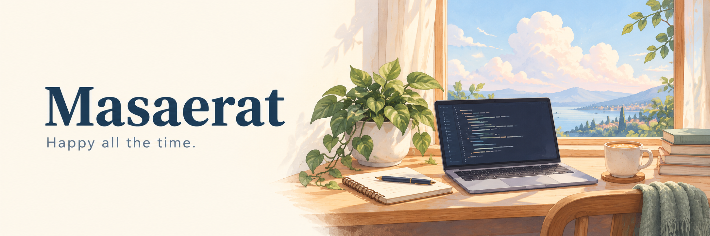

  

<h1 align="center">Hi, I'm Masaerat 👋</h1>

## 🌿 About me

- 🎓 **Education:** Undergraduate studies at **Guangdong University of Technology**, followed by master's studies at **The Hong Kong Polytechnic University**.
- 💻 **Career goal:** Working toward becoming a backend engineer, one project at a time.
- 🤖 **Currently learning:** AI agents and AI application development, exploring how to turn ideas into useful tools.
- 🏀 **Beyond code:** A CP3 fan who enjoys playing basketball, listening to music, and a little K-pop.

## 🪴 My little workshop

| 项目 | 在做什么 |
| :--- | :--- |
| 🏡 **[智能租房 Agent](https://github.com/Masaerat/shangting-lease-ywyVersion)** | 基于尚庭公寓学习项目扩展：将 Java 租赁业务与 Agent、混合 RAG、分层记忆及 MQ 预约通知串起来。 |
| 🗂️ **[Data Platform](https://github.com/Masaerat/dataPlateform)** | 钉钉知识库文档交付后端，支持异步导出、增量同步与有鉴权的 ZIP 交付包。 |
| ✏️ **[AutoDiagram](https://github.com/Masaerat/autoDiagram)** | 从文字或音视频转写生成流程图，支持 SVG / PNG 预览及 Draw.io XML 下载。 |
| 📖 **[Local PDF RAG](https://github.com/Masaerat/RAGdemo)** | 基于 Spring AI 与 Qdrant 的本地 PDF 问答练习，让回答能够追溯到来源片段。 |

## ☁️ Things I'm exploring

**后端与工程** &nbsp; Java · Spring Boot · MySQL · Redis · RabbitMQ · Docker

**AI 应用** &nbsp; Spring AI · RAG · Tool Calling · 向量检索

**工具与界面** &nbsp; TypeScript · React · Node.js · Python

 

  Keep learning. Keep building. Stay curious. 🌱

